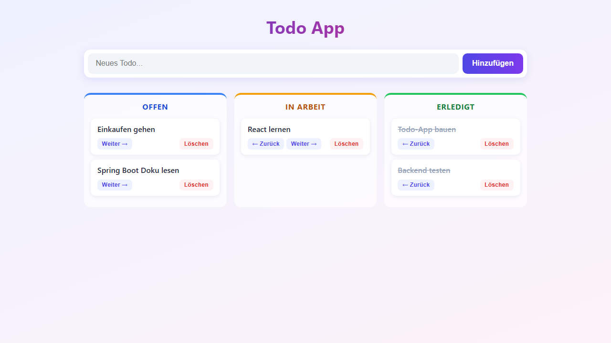

# Todo Frontend

Ein React-Frontend für die Todo-App-Übung bei neue fische — gebaut mit Vite, TypeScript und axios. Die Todos werden auf einem Kanban-Board mit drei Spalten (Offen, In Arbeit, Erledigt) angezeigt und können angelegt, verschoben und gelöscht werden.

Das zugehörige Backend (Spring Boot + MongoDB): [java-todo-backend-training](https://github.com/codeByFrank/java-todo-backend-training)



## Tech-Stack

- React 19 + TypeScript
- Vite (Dev-Server & Build)
- axios (HTTP-Client)
- Vitest (Tests)

## Features

- Alle Todos laden und nach Status in Spalten anzeigen
- Neues Todo anlegen (startet als `OPEN`)
- Status per Button vor- und zurückschieben (`OPEN` ↔ `IN_PROGRESS` ↔ `DONE`)
- Todo löschen

## Starten

Voraussetzungen: Node.js, laufendes Backend auf Port 8080 (inkl. MongoDB).

```
npm install     # einmalig: Abhängigkeiten installieren
npm run dev     # Dev-Server starten
```

Dann http://localhost:5173 im Browser öffnen.

Der Vite-Dev-Server leitet alle `/api`-Anfragen per Proxy an das Backend auf `http://localhost:8080` weiter (siehe `vite.config.ts`) — deshalb genügen in den axios-Aufrufen relative Pfade und es gibt keine CORS-Probleme.

## Tests

```
npm test
```

Die Tests mocken axios — es ist kein laufendes Backend nötig.

## Projektstruktur

```
src/
├── models/      # TypeScript-Typen (Todo, TodoStatus)
├── services/    # API-Aufrufe mit axios + Tests
├── components/  # React-Komponenten
└── App.tsx      # Hauptkomponente (State & Zusammenbau)
```
